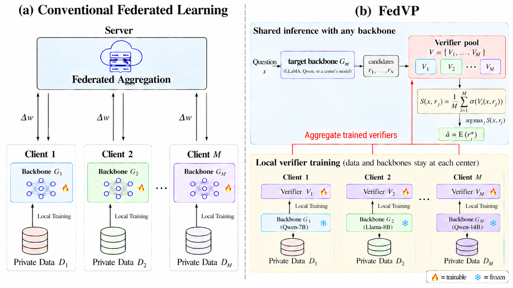

# FedVP

**Federated Learning across Heterogeneous Models by Pooling Locally Trained Verifiers**

Yifan Li · Xi Chen

[Paper (arXiv)](https://arxiv.org/abs/2611.13708)

FedVP lets clients collaborate while retaining independently chosen LLM backbones. Each client trains a verifier on local questions and responses from its frozen generator. Clients share the trained verifiers; the resulting pool combines their judgments at inference, without averaging model parameters or requiring a shared training dataset.



## How it works

1. **Train locally.** Generate eight responses per local training question. Fine-tune the client's chosen verifier with answer-correctness BCE, updating its LoRA adapters and native scoring components.
2. **Share verifiers.** Collect the independent trained verifiers. Generator weights and local training data stay at their clients.
3. **Select collectively.** Any target backbone generates candidates. Average the verifiers' sigmoid scores and select the highest-scoring response. The same pool can serve different target backbones without additional verifier training.

The heterogeneous configuration has five clients with different generators and verifiers. The Uniform configuration comprises two separate, single-source runs: one LLaMA-only pool and one Qwen-only pool. Full model IDs and settings are in [the protocol](docs/protocol.md) and [configuration](configs/paper_experiments.json).

[Reproduction guide](docs/reproduction.md) · [Baseline implementations](docs/baselines.md) · [Paper results](docs/results.md)

## Installation

Use Python 3.11 and a Linux CUDA environment for model training and inference. CPU table inspection and aggregation also work on Windows.

```bash
python -m venv .venv
source .venv/bin/activate
# Install the PyTorch 2.6.0 build appropriate to your CUDA environment first.
python -m pip install -r requirements-verifier.txt -r requirements-data.txt
```

`requirements-verifier.txt` records the heterogeneous verifier environment. Generation uses the separate recorded SGLang/CUDA 11.8 stack in `requirements-generation-cu118.txt`; use a separate environment for it. See [reproduction](docs/reproduction.md) for commands and artifact formats.

## Reproduce FedVP

### Prepare data and pretrained model snapshots

```bash
python scripts/fetch_upstream.py
python scripts/prepare_data.py --datasets pubmedqa medmcqa medqa mmlu
# Place the BioASQ source files as described in docs/data.md, then:
python scripts/prepare_data.py --datasets bioasq

python scripts/download_models.py \
  --model-id meta-llama/Llama-3.2-3B-Instruct \
  --output models/Llama-3.2-3B-Instruct
python scripts/download_models.py \
  --model-id Ray2333/GRM_Llama3.1_8B_rewardmodel-ft \
  --output models/GRM_Llama3.1_8B_rewardmodel-ft
```

Some model repositories require accepted access terms and a locally authenticated Hugging Face account. All model-loading commands below take local snapshot paths.

### Generate candidates and train a local verifier

Example for Client A (BioASQ):

```bash
# Run in the generation environment, using your selected available GPU.
CUDA_VISIBLE_DEVICES=0 python scripts/run_heterogeneous_candidates.py \
  --model-name Llama-3.2-3B-Instruct \
  --model-path models/Llama-3.2-3B-Instruct \
  --datasets bioasq --splits train,test

# Run in the verifier environment.
CUDA_VISIBLE_DEVICES=0 python scripts/train_heterogeneous_verifier.py \
  --center bioasq \
  --candidates outputs/best_of_n/Llama-3.2-3B-Instruct/bioasq_best_of_n/train/train_best_of_n.json \
  --model-path models/GRM_Llama3.1_8B_rewardmodel-ft \
  --model-id Ray2333/GRM_Llama3.1_8B_rewardmodel-ft \
  --output-dir runs/heterogeneous/client_A
```

Repeat the same local procedure using each client's assignment. Client D uses `--verifier-kind armorm`; the others use the default native scalar-head loader. Defaults retain the paper's two epochs, effective batch 32, learning rate `1e-4`, LoRA rank 16/alpha 32/dropout 0.05 and seed 42. Uniform uses this same entry point with one matching generator source and Skywork-Llama initialization for every center.

### Score and pool

Score the same target candidate file with each trained verifier, then combine the saved scores on CPU. Detailed commands are in [reproduction](docs/reproduction.md). The default is mean probability with first-candidate exact ties. Single pretrained and distilled verifiers use sigmoid ranking too.

Optional [distillation](docs/distillation.md) compresses the original heterogeneous pool into one Skywork V2-Qwen3 student, either shared after public-data distillation or separately trained at each center.

## Repository contents

```text
scripts/       Candidate generation, local training, scoring, pooling and distillation
configs/       Paper model assignments, hyperparameters and fixed reference IDs
results/       Main-body tables and N=1,2,4,8 figure coordinates
assets/        Overview and scaling figures
docs/          Data, protocol, reproduction and baseline instructions
tests/         CPU mechanical checks of scoring, training and result consistency
```

The repository contains code and reported results. Trained checkpoint weights and the full per-candidate archives are not bundled or hosted by this preparation. The reproduction commands train from the listed pretrained snapshots.

## Checks

```bash
python -m pip install -r requirements-dev.txt
python -m unittest discover -s tests -v
```

Checks use synthetic tensors and saved result values. They do not launch the full experiments.

## Citation

```bibtex
@misc{li2026fedvp,
  title = {FedVP: Federated Learning across Heterogeneous Models by Pooling Locally Trained Verifiers},
  author = {Li, Yifan and Chen, Xi},
  year = {2026},
  eprint = {2611.13708},
  archivePrefix = {arXiv},
  primaryClass = {cs.LG},
  url = {https://arxiv.org/abs/2611.13708}
}
```

See [license status](LICENSE_STATUS.md) and [third-party sources](THIRD_PARTY.md).
