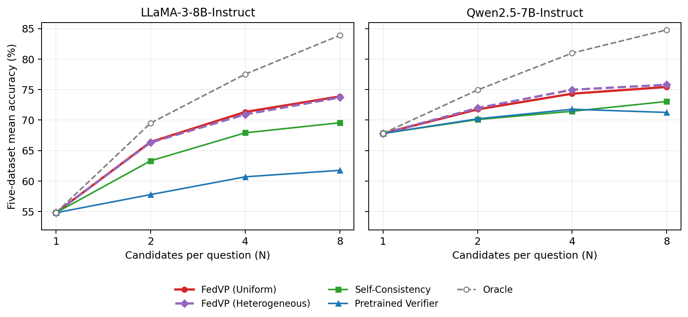

# Results in the manuscript

The files in `results/` are a snapshot of the current manuscript's main-body tables and candidate-budget figure. Accuracy is expressed as a percentage. Each reported average equally weights the five complete test datasets: BioASQ (124 questions), MedMCQA (4,183), MedQA (1,273), MMLU-Med (163), and PubMedQA (500).

## Inspect the results

These commands use only Python's standard library and do not load models:

```bash
python scripts/show_results.py --list
python scripts/show_results.py --table main_results
python scripts/show_results.py --table model_heterogeneous_comparison
python scripts/show_results.py --table heterogeneous_leave_one_out
python scripts/show_results.py --table verifier_distillation --json
```

The machine-readable source is [`paper_tables.json`](../results/paper_tables.json). It preserves the displayed table values; averages and changes in accuracy were calculated before rounding in the experiments. For example, the public distilled verifier's LLaMA change is +0.84 percentage points although subtracting the rounded averages 74.55 and 73.70 gives 0.85.

| Table | Key | Contents |
| --- | --- | --- |
| 1 | `client_configuration` | The five heterogeneous client assignments |
| 2 | `main_results` | Eight conventional federated baselines and both FedVP configurations |
| 3 | `model_heterogeneous_comparison` | FedMD, FedMKT, their SC variants, and FedVP Heterogeneous |
| 4 | `cross_generator_baselines` | Each trained verifier reused across five target backbones, the pooled result, and pretrained diagonal values |
| 5 | `verifier_distillation` | The original heterogeneous teacher pool, a shared public student, and separate local students |
| 6 | `uniform_training_by_dataset` | Single-response, SC, pretrained verification, and trained-pool comparisons |
| 7 | `uniform_ablations` | Four aggregation rules under Uniform and Heterogeneous |
| 8 | `heterogeneous_leave_one_out` | Removing each client verifier from the heterogeneous pool |

The [LaTeX fragments](../results/tables/) are copied from the current manuscript without editing their values. They require `booktabs`, `xcolor` with its `table` option, a `\ours` macro for FedVP, and the manuscript's `oursrow` color.

## Configurations represented by the tables

- **Heterogeneous:** one trained five-verifier pool is reused across target backbones. Client A is BioASQ/GRM; B is MedMCQA/Skywork-Llama; C is MedQA/OffsetBias; D is MMLU-Med/ArmoRM; E is PubMedQA/Skywork-Qwen3.
- **Uniform:** LLaMA and Qwen use separate five-verifier pools. Every center in a run generates its training candidates using that run's one backbone; all verifiers start from Skywork-Llama v0.2.
- **Table 3:** FedMD and FedMKT use a 1,442-question public reference set and 12,979 private questions. The FedVP row is the main-table heterogeneous pool, trained only on the original client-local data. It is not the earlier experimental pool trained with the shared-reference protocol.
- **Distillation:** both variants use the main-table heterogeneous pool as teacher. The public variant is one shared Skywork V2-Qwen3 student; the local variant uses a separately trained student for each test center. The teacher and students select from the same saved candidates.
- **Pretrained comparison:** the single verifier is Skywork-Llama v0.2; the pretrained pool contains the five heterogeneous released verifiers before local fine-tuning. Single-verifier selection uses sigmoid scores. Pools average member sigmoid scores; exact ties use the earliest candidate. The mean-logit row in the aggregation ablation is the explicitly reported alternative rule.

## Candidate-budget figure

[`candidate_scaling.json`](../results/candidate_scaling.json) contains the coordinates from the current Figure 2 TeX source. It includes only the reported nested budgets `1, 2, 4, 8`; all methods use the same first N saved candidates. The Oracle curve reports whether any candidate in that prefix is correct. The pretrained curve uses sigmoid ranking, including the current rescored values.

```bash
python -m pip install matplotlib
python scripts/plot_results.py
```

This produces [`assets/candidate_scaling.png`](../assets/candidate_scaling.png) from the saved values without model inference. The original [PGFPlots source](../results/candidate_scaling.tex) is also included.



Only manuscript results are included here. This directory does not contain raw medical questions, model weights, private machine paths, job logs, or unfinished candidate-budget experiments.
